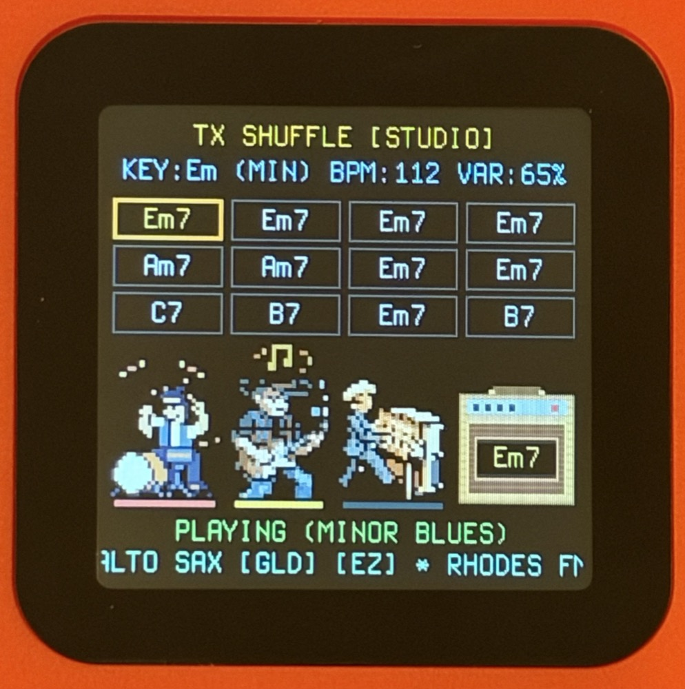

# Blues Box

**A standalone 12-bar blues backing band firmware for the M-VAVE FM-1 pocket synthesizer.**

[](https://github.com/provostprovost/blues/actions)
[](LICENSING.md)

Turn your **M-VAVE FM-1** into an always-ready blues rhythm section—drums, walking bass, and comping chords—that follows a real 12-bar or 8-bar form while you solo on guitar or play the built-in 4-voice lead keyboard.

- **Real blues & funk accompaniment:** 19 groove/drum beat patterns (including 70s Pocket Funk, NOLA Meters Funk, Blues-Funk, Slow Neo-Funk, and Country Twang), 14 bass engines, 12 bass line styles, 18 keyboard tones, 12 keys rhythm styles, and 12 drum kits—with independent Bass, Keys, and Drums **Fullness** and **Variation** controls.
- **Playable lead synth + Easy Mode:** 25 solo voices + 4 Lead Play Styles (`Poly`, `Legato Glide`, `Blues Bend`, `Octave Stack`) across 27 backlit keys, with the current chord's root lit full white and the active blues scale glowing under your fingers (both playing and stopped). Startup Preset 1 defaults to **Alto Sax + Legato Glide + Easy Lead** (`GLO` + `LFO` to toggle) so any unlit out-of-scale key smoothly bends up into the next scale note.
- **Musical Intros & Next-Measure Outros:** Opt-in style-matched 1, 2, or 4-bar **Lead-In Riffs** (`REC` when stopped) and 5 scripted **Outro Riffs** (`EDIT` when stopped)—including the classic `#I9 -> I9` half-step slide and an instant Beat-1 `STINGER`. Press `REC` or `EDIT` (or stomp your MIDI footswitch) mid-song to trigger the outro on the **very next measure**.
- **M-VAVE Chocolate & MIDI ready:** Plug-and-play support for the M-VAVE Chocolate 4-switch pedal (`PC 0..3`, `CC 80..83`, `CC 20..23`, `Note 60/62/64/65`) over USB-MIDI or 3.5mm TRS MIDI IN, plus external MIDI Clock sync and MIDI Out (`Ch 2` Bass, `Ch 3` Keys, `Ch 10` Drums).
- **16 named preset slots:** Hold **`SAVE`** or **`GLO`** and tap any of the 16 white keys to load named factory styles (`1: TEXAS SHUFFLE` … `16: BO DIDDLEY`) or save your own setups (`USER SETTINGS 1` … `USER SETTINGS 16`) in flash.

| Lead Sheet | Band Mixer | Band Style | Band Feel |
|---|---|---|---|
|  |  |  |  |

---

## Quick Start (Web Installer — No Setup Required)

> **Compatibility, Backup & Disclaimer:** Built and tested on the **M-VAVE FM-1** (original hardware). Before flashing custom firmware, back up any stock FM-1 patterns/presets you want to keep using M-Vave's desktop/web tool. **Use at your own risk**—this firmware is provided as-is with no warranty, and the author is not responsible if flashing or using it damages or bricks your device. You can restore stock firmware using the steps in [Recovery](#recovery--restoring-stock-firmware).

1. Plug the FM-1 into your computer with a USB-C data cable and power it on.
2. Open the **[Blues Box Web Installer](https://provostprovost.github.io/blues/)** in **Chrome, Edge, or Opera** and click **Connect & Install Blues Box** *(zero Python or CLI setup needed)*.

<details>
<summary>Alternative: Flash from CLI (Python)</summary>

1. `pip install mido python-rtmidi`
2. Download **`bluesbox.fwsc`** from the [Releases page](https://github.com/provostprovost/blues/releases) *(or run `./build.sh`)*, then flash:
   ```bash
   python3 tools/fm1_install.py bluesbox.fwsc --yes
   ```

</details>

3. Once the FM-1 reboots, press **`PLAY/STOP`** to start the band.
4. Turn **`SELECT`** to change the groove, **`KNOB1`** for tempo, **`ALGORITHM`** for chords, and **`PRESETS`** for the lead keyboard sound.

---

## Panel Layout

```text
+-------------------------------------------------------------------+
| [MASTER]  [SELECT]   +---------------+   [KNOB1] [KNOB2] [KNOB3] [KNOB4]
|                      |  240x240 LCD  |                            |
| [PRESETS] [ALGORITHM]|  Lead Sheet / |   [FX]  [SEL] [ENV] [LFO] [EDIT] [GLO]
|                      |  Band Mixer   |   [HOME][SAVE][ARP] [SEQ] [PLAY] [REC]
|      [OCT-] [OCT+]   +---------------+                            |
|                                                                   |
|  [F] [F#] [G] [Ab] [A] [Bb] [B] [C] [C#] [D] [Eb] [E] ... (27 keys)
+-------------------------------------------------------------------+
```

---

## Controls Cheat Sheet

### Knobs

| Knob | Lead Sheet (Screen 1) | Band Mixer (Screen 2) | Band Style (Screen 3) | Band Feel (Screen 4) |
|---|---|---|---|---|
| **`MASTER`** | Hardware master volume | Hardware master volume | Hardware master volume | Hardware master volume |
| **`SELECT`** | Groove Preset (19 grooves)<br>*(Hold `GLO`: Drum Kit, 12 kits)* | Groove Preset<br>*(Hold `GLO`: Drum Kit)* | Groove Preset<br>*(Hold `GLO`: Drum Kit)* | Groove Preset<br>*(Hold `GLO`: Drum Kit)* |
| **`PRESETS`** | Solo Lead Voice (25 voices)<br>*(Hold `SEL`: Key `C`–`B`, Hold `GLO`: Play Style)* | Solo Lead Voice<br>*(Hold `SEL`: Key, `GLO`: Play Style)* | Solo Lead Voice<br>*(Hold `SEL`: Key, `GLO`: Play Style)* | Solo Lead Voice<br>*(Hold `SEL`: Key, `GLO`: Play Style)* |
| **`ALGORITHM`** | Backing Keyboard Tone (18 tones) | Backing Keyboard Tone | Backing Keyboard Tone | Backing Keyboard Tone |
| **`KNOB1`** | Tempo (40–240 BPM)<br>*(Hold `GLO`: Swing 0%–100%)* | Bass Volume<br>*(Hold `GLO`: Reverb Mix)* | Bass Line Style (12 styles)<br>*(Hold `GLO`: Bass Sound, 14)* | Bass Fullness (0%–100%)<br>*(Hold `GLO`: Bass Variation)* |
| **`KNOB2`** | Master Variation (0%–100%)<br>*(Hold `GLO`: Tuning 440/432/442)* | Keys Volume<br>*(Hold `GLO`: Drive / Warmth)* | Keys Rhythm Style (12 styles)<br>*(Hold `GLO`: Drum Kit, 12)* | Keys Fullness (0%–100%)<br>*(Hold `GLO`: Keys Variation)* |
| **`KNOB3`** | Bass Volume<br>*(Hold `GLO`: Bass Sound)* | Drums Volume<br>*(Hold `GLO`: Swing 0%–100%)* | Drum Beat Pattern (19 patterns)<br>*(Hold `GLO`: Intro Style, 7)* | Drums Fullness (0%–100%)<br>*(Hold `GLO`: Drums Variation)* |
| **`KNOB4`** | Keys Volume<br>*(Hold `GLO`: Reverb Mix)* | Lead Volume<br>*(Hold `GLO`: Lead Play Style, `SEL`: Easy Lead)* | Blues Form (5 forms)<br>*(Hold `GLO`: Outro Style, 5)* | Master Fullness (all 3)<br>*(Hold `GLO`: Master Variation)* |

### Buttons

| Button | What It Does |
|---|---|
| **`PLAY/STOP`** | Start or stop playback (LED lights up while playing; blinks when an Outro is armed). |
| **`REC`** | **Stopped:** Cycle **Intro Style** (`OFF`, `AUTO`, `1B V7`, `2B TURN`, `2B FUNK`, `4B BAND`, `1B CLICK`; LED lights when armed).<br>**Playing:** Arm/cancel **Next-Measure Outro** (`OUTRO NEXT BAR`). |
| **`EDIT`** | **Stopped:** Cycle **Outro Style** (`CLASSIC SLIDE`, `V-bV-IV-I`, `IV-I TURN`, `1B QUICK`, `STINGER`).<br>**Playing:** Arm/cancel **Next-Measure Outro** (`OUTRO NEXT BAR`). |
| **`OCT-` / `OCT+`** | Shift the 27-key solo keyboard down or up (-2 to +2 octaves). Hold `SEL` + `OCT-`/`OCT+` to nudge tempo ±4 BPM. |
| **`HOME`** | Cycle screens: **Lead Sheet** → **Band Mixer** → **Band Style** → **Band Feel** → **Lead Sheet**. |
| **`SAVE`** | Save your current groove, tempo, key, voices, styles, and mixer levels to flash. |
| **`GLO`** | Secondary knob layer (bottom half of Mixer & Band Style, plus quick Lead Sheet tweaks). |
| **`ARP`** | Tap Tempo—tap in rhythm to set the BPM. |
| **`FX`** | Trigger a manual full-band accent stab + crash. |
| **`ENV`** | Vamp Mode—freeze the progression and loop the current chord. |
| **`SEQ`** | Trigger a 4-bar stop-time break with beat-1 stabs. |
| **`LFO`** | Toggle **Major 12-Bar** ↔ **Minor Blues** *(Hold `GLO` + `LFO` or `SEL` + `LFO`: toggle **Easy Lead** scale-bend mode)*. |
| **`SEL`** | Key & shortcut modifier: `SEL` + `PRESETS` (Key), `SEL` + `OCT-`/`OCT+` (BPM ±4), and `SEL` + silicone keys. |

---

## "How Do I…" Quick Recipes

- **Change the key:** Hold **`SEL`** and turn **`PRESETS`**. Or hold **`SEL`** and tap one of the first 12 silicone keys (`F` through `E`): a single tap queues the key change for the next chorus, and a quick double tap switches right away.
- **Switch between Major and Minor Blues:** Press **`LFO`** for a one-tap toggle. You can also turn **`KNOB4`** on the **Band Style** screen, or hold **`SEL`** and press Key 22 (Minor) / Key 18 (Major). Minor Blues shows **`KEY:Em (MIN)`** in cyan at the top of the screen and updates all 12 chord boxes (`Em7`, `Am7`, `C7`, `B7`).
- **Customize Bass, Keys, and Drum patterns separately:** Press **`HOME`** twice to open **Band Style**, then turn **`KNOB1`** (Bass Line), **`KNOB2`** (Keys Rhythm), **`KNOB3`** (Drum Beat), and **`KNOB4`** (Blues Form). Hold **`GLO`** on the same screen for Bass Sound, Drum Kit, Intro Style, and Outro Style.
- **Make the chords and bass jazzier:** Turn **`KNOB2`** (**Variation**). Low (0–30%) keeps it straight and simple; middle (31–65%) adds 9ths, 13ths, and chromatic bass walk-ups; high (66–100%) adds passing diminished chords, tritone subs, and turnaround chords in Bars 11–12.
- **Dial in sparse vs. full-band energy:** Press **`HOME`** three times to open **Band Feel** for independent Bass/Keys/Drums **Fullness** (`KNOB1–3`) and **Variation** (`GLO + KNOB1–3`), or turn `KNOB4` (**Master Fullness** / `GLO + KNOB4` **Master Variation**). At `<20%` Fullness, Bass plays 1 root note per bar (`20–39%` plays `1–5`) and Drums strip down to rimshot on beats 2 & 4 (`20–44%` adds quarter-note hat + Beat 1 kick + snare, `45–74%` adds full shuffle hat + Beat 3 kick, `75%+` full kit); higher Variation adds chromatic bass walk-ups, 9th/13th/passing chords, ghost snares, and Bar 4/8/12 drum fills.
- **Adjust shuffle feel:** Hold **`GLO`** and turn **`KNOB1`** (**Swing**), or press **`HOME`** to open the Band Mixer and hold **`GLO`** + turn **`KNOB3`**. 0% is straight 8ths, ~67% is a classic triplet shuffle, and 100% is a hard dotted-8th swing.
- **Play along on the keys:** Just play the 27 silicone keys—they act as a 4-voice polyphonic lead synth with automatic finger vibrato on held notes. While playing, the key LEDs light **full white** on the current chord's root (e.g. `E` on `I`, `A` on `IV`, `B` on `V` in E Blues), **half white** on the rest of the active blues scale (**Minor Blues** in Minor form or on `IV7`/`V7`, **Major Blues** on `I7` in Major forms), and **off** on non-scale notes.
- **Use a Lead-In Intro & trigger a Next-Measure Outro:** Press **`REC`** while stopped to arm a style-matched 1, 2, or 4-bar **Intro** (the `REC` LED stays lit), and press **`EDIT`** while stopped to pick your **Outro** (`SLIDE`, `V-bV-IV`, `IV-I TRN`, `1B QUICK`, or `STINGER`). While playing, press **`REC`** or **`EDIT`** (or hold **`SEL`** + Keys `23–26`) during *any* bar to queue **`OUTRO NEXT BAR`**—the band plays a Beat-4 pickup fill, executes the scripted outro on the very next measure, and lands cleanly on a Beat-1 `I9` stinger.
- **Save & load across 16 preset slots:** Hold **`SAVE`** (the 16 white keys flash, with the active slot solid bright) and tap any white key to save your setup to Slots 1–16 (or just tap `SAVE` quickly to save to the current slot). Hold **`GLO`** and tap any white key to load Slots 1–16. Background autosave is intentionally off so temporary jam tweaks don't overwrite your saved presets.

<details>
<summary>All <code>SEL</code> + Silicone Key Shortcuts (Keys 0–26)</summary>

- **Keys 0–11 (Key Select):** `0=F`, `1=F#`, `2=G`, `3=Ab`, `4=A`, `5=Bb`, `6=B`, `7=C`, `8=C#`, `9=D`, `10=Eb`, `11=E` (single tap = next chorus, double tap = immediate)
- **Keys 12–17 (Live Cues):** `12` Return to 12-Bar, `13` Vamp Toggle, `14` 4-Bar Stop-Time, `15` Hold Chord, `16` Jump to Turnaround, `17` Accent Stab
- **Keys 18–22 (Form Variations):** `18` Standard 12-Bar, `19` Quick-Change (IV in Bar 2), `20` 1-4-5 Opening, `21` 8-Bar Blues, `22` Minor Blues
- **Keys 23–26 (Outros):** `23` Classic Slide, `24` V–bV–IV–I, `25` IV–I Turnaround, `26` 1-Bar Quick Tag *(use `EDIT` or `Band Style` `[G] OUTRO` for `STINGER`)*

</details>

---

## The Sounds & Styles

- **19 Groove / Drum Beat Patterns (`SELECT`):** 12/8 Slow Blues, Texas Shuffle, Chicago Swing, Rockin' Blues, New Orleans 2nd Line, Memphis Soul, Rhumba Blues, Boogie-Woogie, Purdie Shuffle, Train Beat, Bo Diddley, Jazz Shuffle, Gospel Swing, Delta Stomp, 70s Pocket Funk, NOLA Funk, Swung Blues-Funk, Slow Neo-Funk, Country Twang.
- **18 Keyboard Tones (`ALGORITHM`):** Rhodes FM, Bright FM EP, Wurlitzer 200A, Clean B3 Organ, Dirty Gospel B3, Clavinet D6, Archtop Rhythm Guitar, Blues Horns, Honky-Tonk Piano, Tremolo Suitcase EP, Delta Resonator Guitar, Rotary Leslie Organ, Cajun Accordion, Vibraphone, Farfisa Combo Organ, Mellotron Strings, CP-70 Electric Grand, Harmonium.
- **25 Solo Lead Voices (`PRESETS`):** Overdriven Blues Guitar, Chicago Blues Harp, Alto Sax, Tenor Sax, Baritone Sax, Muted Blues Trumpet, Brass Section, Jazz Flute, Blues Whistle, Moog Lead, Warm Jazz Hollowbody, Fuzz Octave, Percussive B3 Organ, Screaming Rock B3, Talk-Box Vowel Lead, Slide / Lap Steel Guitar, Auto-Wah Guitar, Telecaster Twang, Blues Fiddle, Banjo / Dobro, Wavefolder Synth, Hard-Sync Analog Lead, SID Chiptune Lead, Steelpan, Theremin.
- **4 Lead Play Styles (`GLO` + `PRESETS`) + Easy Lead (`GLO` + `LFO`):** Natural Poly, Mono Legato Glide, Blues Scoop/Bend, Octave Stack—plus optional **Easy Lead** mode where unlit non-scale keys bend smoothly up into the next scale note.
- **14 Bass Engines (`GLO` + `KNOB3`):** Fender P-Bass, Upright Double Bass, Muted Tic-Tac Boogie, Moog Funk Synth, 60s Jazz Bass, Flatwound Motown, Ampeg Tube Growl, Sub Octave, Lately FM Bass, Slap/Pop Bass, Hofner Beatle Bass, Acid 303 Bass, NOLA Tuba, Distorted Pick Bass.
- **12 Bass Line Styles (`Band Style` `KNOB1`):** Walking 4/4, Shuffle, Boogie Box, Root-5th, Funk Sync, Rumba, Gospel Walk, 12/8 Roll, Motown 8ths, 2nd Line, Funk 16ths, Country 2-Beat.
- **12 Keys Rhythm Styles (`Band Style` `KNOB2`):** Charleston, Backbeat 2&4, Call & Response, Sparse Pad, Chop 4/4, Stride, Boogie 8ths, Gospel Swell, Rumba Montuno, 12/8 Arpeggio, Funk Clav 16th, Country Chop.
- **12 Drum Kits (`GLO` + `SELECT`):** Studio Punch, Vintage Brush, Retro 808, Stax Tight, Chicago Room, Dry Vintage, Jazz Club, Heavy Blues-Rock, CR-78 Analog, NOLA Percussion, Linn Gate, Lo-Fi Box.

---

## Display Screens

Press **`HOME`** to cycle through the four screens:

1. **12-Bar Lead Sheet:** Shows the groove and drum kit at the top, Key + Form (`(MAJ)` or cyan `(MIN)`), BPM, and Variation below it, the 12-bar chord grid with the active bar highlighted in amber, 4 beat pips, live playback status (`PRESS PLAY [OUT:SLIDE]`, `INTRO:`, `OUTRO NEXT BAR:`, and 1.5s parameter toasts), and the footer (`<Solo Lead> * <Keyboard Tone>`).
2. **Band Mixer:** Live controls for `BASS VOL`, `KEYS VOL`, `DRUMS VOL`, `LEAD VOL` (`KNOB1–4`) and `REVERB`, `DRIVE`, `SWING`, `LEAD PLAY` (`GLO` + `KNOB1–4`).
3. **Band Style:** Direct rhythm & tone editor for `BASS LINE`, `KEYS RHY`, `DRUM BEAT`, and `FORM` (`KNOB1–4`), plus `[G] BASS`, `[G] KIT`, `[G] INTRO`, and `[G] OUTRO` (`GLO` + `KNOB1–4`).
4. **Band Feel:** Per-instrument `BASS FUL`, `KEYS FUL`, `DRUMS FUL`, `MSTR FUL` (`KNOB1–4`) and `[G]BS VAR`, `[G]KY VAR`, `[G]DR VAR`, `[G]MS VAR` (`GLO` + `KNOB1–4`).

---

## MIDI & Footswitch (M-VAVE Chocolate)

Blues Box listens on both **USB-MIDI** and the **3.5mm TRS MIDI IN** jack (for wireless BLE-to-TRS adapters like the M-VAVE MS1), and transmits **MIDI Out** (`Ch 2` Bass, `Ch 3` Keys, `Ch 10` Drums, plus `0xF8` Clock) over USB.

### M-VAVE Chocolate 4-Switch Mapping (Zero-Config)
Works out of the box with default **`PC 0–3`**, as well as **`CC 80–83`**, **`CC 20–23`**, or **`Note C4/D4/E4/F4` (`60/62/64/65`)**:

| Switch | MIDI Triggers | When Stopped | When Playing |
|---|---|---|---|
| **Switch A** | `PC 0`, `CC 80`, `CC 20`, `Note 60` | **Start Song** (uses current Intro mode) | **Arm Next-Measure Outro** *(tap again during outro to hard-stop)* |
| **Switch B** | `PC 1`, `CC 81`, `CC 21`, `Note 62` | **1-Stomp Start WITH Style Intro** *(even if Intro is `OFF`)* | **Drum Fill** *(2nd press: Force Turnaround)* |
| **Switch C** | `PC 2`, `CC 82`, `CC 22`, `Note 64` | **Cycle Intro Style** | **Queue Stop-Time Break** |
| **Switch D** | `PC 3`, `CC 83`, `CC 23`, `Note 65` | **Cycle Outro Style** | **Toggle I–IV Vamp Loop** |

- **Sustain Pedal (`CC 64`):** Hold current chord (`>=64`).
- **External Clock & Transport:** Responds to MIDI `Start (0xFA)`, `Stop (0xFC)`, and `Clock (0xF8)`.

---

## Building from Source & Tests

Requires Docker (macOS/Windows) or Linux x86-64 with the JieLi toolchain, plus Python 3 (`Pillow`, `mido`, `python-rtmidi`).

```bash
# First-time toolchain setup (Linux/Docker)
./tools/get_toolchain.sh

# Build the firmware package (outputs build/bluesbox.fwsc)
./build.sh

# Run the full host, MIDI, flash, OTA, and C engine unit test suite
sh tests/run_tests.sh
```

<details>
<summary>Code Layout</summary>

| File | Role |
|---|---|
| `firmware/src/dinghy.c` | App entry, audio ISR (`app_audio`), MIDI ring buffer, factory presets, superloop |
| `firmware/src/blues_harmony.c` | 12-bar / 8-bar / Minor Blues state machine, Lead-In & Next-Measure Outro states |
| `firmware/src/blues_arranger.c` | Groove templates, bass/keys/drum generators, scripted intro & outro riffs |
| `firmware/src/dsp_voices.c` | Fixed-point Q15 synth engines, 25 lead voices, mixer, reverb, saturator |
| `firmware/src/panel_input.c` | Front-panel scanning, 27-key shortcuts, M-VAVE Chocolate & MIDI IN handler |
| `firmware/src/ui_screens.c` | 240×240 LCD screens (Lead Sheet, Mixer, Style, Feel) and boot splash |
| `tests/test_blues_engine.c` | Standalone C unit tests (harmony, arranger, DSP, panel, V2 intros/outros/footswitch) |

</details>

---

## Recovery & Restoring Stock Firmware

- **USB Rescue Mode:** Hold **`OCT-`** while turning on the power switch to boot into the USB updater.
- **Reflash Blues Box:** `python3 tools/fm1_install.py build/bluesbox.fwsc --yes`
- **Restore Stock Firmware:** Use M-Vave's updater with your factory firmware package, or flash a backup package with `tools/fm1_install.py`.

---

## License & Credits

Distributed under the **GNU General Public License v3.0 (GPL-3.0)**. See [LICENSING.md](LICENSING.md) for full per-file attribution and third-party licenses.

Built on [Dinghy](https://github.com/zvenson/dinghy) by **zvenson**, which stands on the work of **Leo Kuroshita (@kurogedelic, Hügelton Instruments)** ([Felucca](https://github.com/hugelton/Felucca)), **isod89** ([SLOOP](https://github.com/isod89/sloop-fm1)), **M. Geisler (genkigenki / makkuro)** ([genkigenki/sloop-fm1](https://github.com/genkigenki/sloop-fm1) — installer, packer, and loader), **illuminus5** ([Skiff](https://github.com/illuminus5/skiff) — update loader screen), and **ChanceTheMaker / keremimo** (Felucca Salt).
