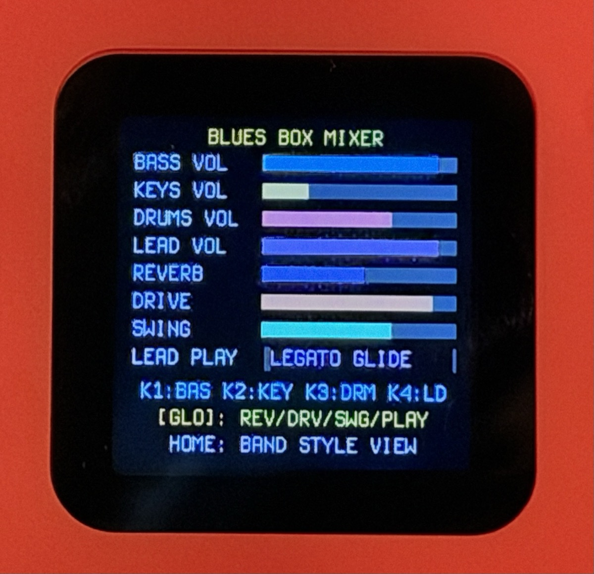
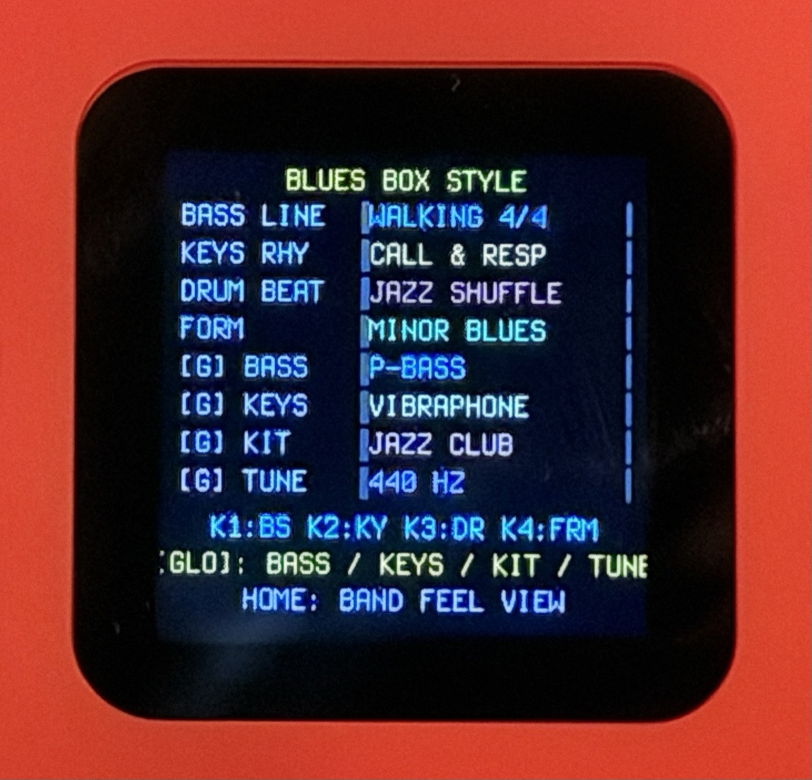
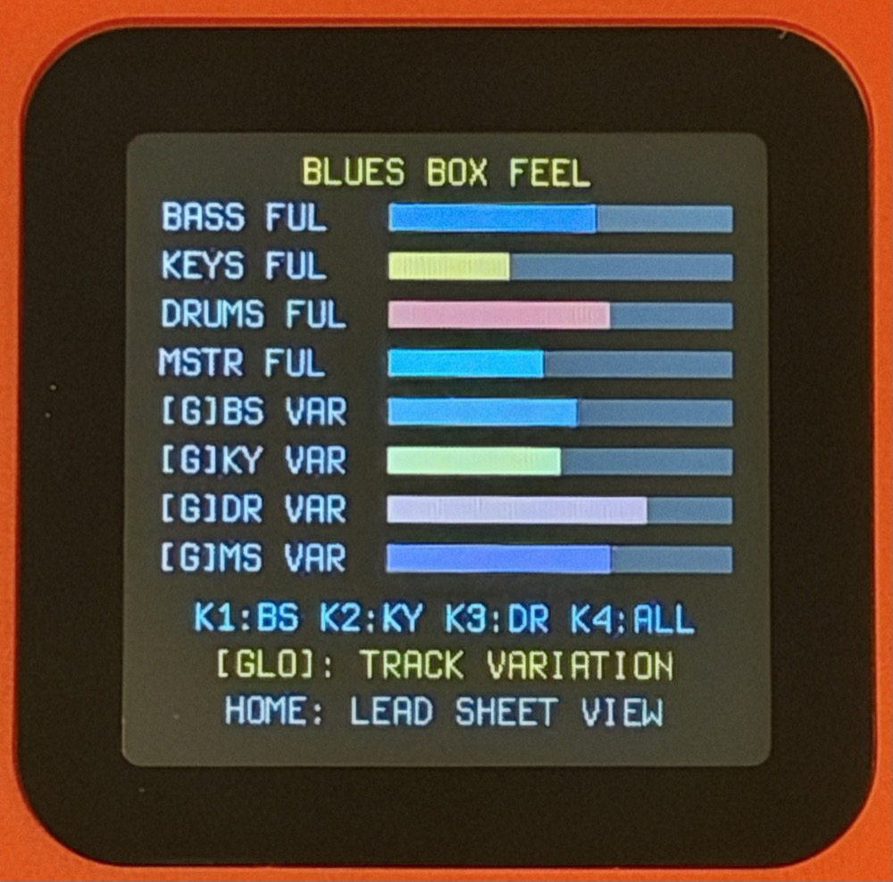

# Blues Box

**A standalone 12-bar blues backing band firmware for the M-VAVE FM-1 pocket synthesizer.**

[](https://github.com/provostprovost/blues/actions)
[](LICENSING.md)

Turn your **M-VAVE FM-1** into an always-ready blues rhythm section—drums, walking bass, and comping chords—that follows a real 12-bar or 8-bar form while you solo on guitar or play the built-in 4-voice lead keyboard.

- **Real blues accompaniment:** 14 groove/drum beat patterns, 14 bass engines, 10 bass line styles, 18 chord engines, 10 keys rhythm styles, and 12 drum kits—with independent Bass, Keys, and Drums **Fullness** and **Variation** controls.
- **Playable lead synth:** 14 solo voices + 4 Lead Play Styles (`Poly`, `Legato Glide`, `Blues Bend`, `Octave Stack`) across 27 backlit keys, with the current chord's root lit full white and the active blues scale glowing under your fingers.
- **Live jam controls:** Toggle major/minor blues, trigger stop-time breaks, vamp on a chord, cue a turnaround, or arm a root-resolving ending on the fly.
- **16 preset slots:** Hold **`SAVE`** or **`GLO`** and tap any of the 16 white keys to save and recall up to 16 complete setups in flash.

| Lead Sheet | Band Mixer | Band Style | Band Feel |
|---|---|---|---|
|  |  |  |  |

---

## Quick Start (Web Installer — No Setup Required)

> **Compatibility & Backup:** Built and tested on the **M-VAVE FM-1** (original hardware). Before flashing custom firmware, back up any stock FM-1 patterns/presets you want to keep using M-Vave's desktop/web tool. You can restore stock firmware anytime (see [Recovery](#recovery--restoring-stock-firmware)).

1. Plug the FM-1 into your computer with a USB-C data cable and power it on.
2. Open the **[Blues Box Web Installer](https://provostprovost.github.io/blues/)** in **Chrome, Edge, or Opera** and click **Connect & Install Blues Box** *(zero Python or CLI setup needed)*.

<details>
<summary>Alternative: Flash from CLI (Python)</summary>

1. `pip install mido python-rtmidi`
2. Download **`bluesbox.fwsc`** from the [Releases page](https://github.com/provostprovost/blues/releases) *(or run `./build.sh`)*, then flash:
   ```bash
   python3 tools/fm1_install.py bluesbox.fwsc --yes
   ```

</details>

3. Once the FM-1 reboots, press **`PLAY/STOP`** to start the band.
4. Turn **`SELECT`** to change the groove, **`KNOB1`** for tempo, **`ALGORITHM`** for chords, and **`PRESETS`** for the lead keyboard sound.

---

## Panel Layout

```text
+-------------------------------------------------------------------+
| [MASTER]  [SELECT]   +---------------+   [KNOB1] [KNOB2] [KNOB3] [KNOB4]
|                      |  240x240 LCD  |                            |
| [PRESETS] [ALGORITHM]|  Lead Sheet / |   [FX]  [SEL] [ENV] [LFO] [EDIT] [GLO]
|                      |  Band Mixer   |   [HOME][SAVE][ARP] [SEQ] [PLAY] [REC]
|      [OCT-] [OCT+]   +---------------+                            |
|                                                                   |
|  [F] [F#] [G] [Ab] [A] [Bb] [B] [C] [C#] [D] [Eb] [E] ... (27 keys)
+-------------------------------------------------------------------+
```

---

## Controls Cheat Sheet

### Knobs

| Knob | Lead Sheet (Screen 1) | Band Mixer (Screen 2) | Band Style (Screen 3) | Band Feel (Screen 4) |
|---|---|---|---|---|
| **`MASTER`** | Hardware master volume | Hardware master volume | Hardware master volume | Hardware master volume |
| **`SELECT`** | Groove Preset (14 grooves)<br>*(Hold `GLO`: Drum Kit, 12 kits)* | Groove Preset<br>*(Hold `GLO`: Drum Kit)* | Groove Preset<br>*(Hold `GLO`: Drum Kit)* | Groove Preset<br>*(Hold `GLO`: Drum Kit)* |
| **`PRESETS`** | Solo Lead Voice (14 voices)<br>*(Hold `SEL`: Key `C`–`B`, Hold `GLO`: Play Style)* | Solo Lead Voice<br>*(Hold `SEL`: Key, `GLO`: Play Style)* | Solo Lead Voice<br>*(Hold `SEL`: Key, `GLO`: Play Style)* | Solo Lead Voice<br>*(Hold `SEL`: Key, `GLO`: Play Style)* |
| **`ALGORITHM`** | Backing Chord Sound (18 engines) | Backing Chord Sound | Backing Chord Sound | Backing Chord Sound |
| **`KNOB1`** | Tempo (40–240 BPM)<br>*(Hold `GLO`: Swing 0%–100%)* | Bass Volume<br>*(Hold `GLO`: Reverb Mix)* | Bass Line Style (10 styles)<br>*(Hold `GLO`: Bass Sound, 14)* | Bass Fullness (0%–100%)<br>*(Hold `GLO`: Bass Variation)* |
| **`KNOB2`** | Master Variation (0%–100%)<br>*(Hold `GLO`: Tuning 440/432/442)* | Keys Volume<br>*(Hold `GLO`: Drive / Warmth)* | Keys Rhythm Style (10 styles)<br>*(Hold `GLO`: Chord Sound, 18)* | Keys Fullness (0%–100%)<br>*(Hold `GLO`: Keys Variation)* |
| **`KNOB3`** | Bass Volume<br>*(Hold `GLO`: Bass Sound)* | Drums Volume<br>*(Hold `GLO`: Swing 0%–100%)* | Drum Beat Pattern (14 patterns)<br>*(Hold `GLO`: Drum Kit, 12)* | Drums Fullness (0%–100%)<br>*(Hold `GLO`: Drums Variation)* |
| **`KNOB4`** | Keys Volume<br>*(Hold `GLO`: Reverb Mix)* | Lead Volume<br>*(Hold `GLO`: Lead Play Style)* | Blues Form (5 forms)<br>*(Hold `GLO`: Tuning 440/432/442)* | Master Fullness (all 3)<br>*(Hold `GLO`: Master Variation)* |

### Buttons

| Button | What It Does |
|---|---|
| **`PLAY/STOP`** | Start or stop playback (LED lights up while playing). |
| **`REC`** | Toggle 1-bar count-in rimshot click (pulses on Beat 1). |
| **`OCT-` / `OCT+`** | Shift the 27-key solo keyboard down or up (-2 to +2 octaves). Hold `SEL` + `OCT-`/`OCT+` to nudge tempo ±4 BPM. |
| **`HOME`** | Cycle screens: **Lead Sheet** → **Band Mixer** → **Band Style** → **Band Feel** → **Lead Sheet**. |
| **`SAVE`** | Save your current groove, tempo, key, voices, styles, and mixer levels to flash. |
| **`GLO`** | Secondary knob layer (bottom half of Mixer & Band Style, plus quick Lead Sheet tweaks). |
| **`ARP`** | Tap Tempo—tap in rhythm to set the BPM. |
| **`FX`** | Trigger a manual full-band accent stab + crash. |
| **`EDIT`** | Arm or cancel a tag ending at the end of the current chorus. |
| **`ENV`** | Vamp Mode—freeze the progression and loop the current chord. |
| **`SEQ`** | Trigger a 4-bar stop-time break with beat-1 stabs. |
| **`LFO`** | Toggle **Major 12-Bar** ↔ **Minor Blues**. |
| **`SEL`** | Key & shortcut modifier: `SEL` + `PRESETS` (Key), `SEL` + `OCT-`/`OCT+` (BPM ±4), and `SEL` + silicone keys. |

---

## "How Do I…" Quick Recipes

- **Change the key:** Hold **`SEL`** and turn **`PRESETS`**. Or hold **`SEL`** and tap one of the first 12 silicone keys (`F` through `E`): a single tap queues the key change for the next chorus, and a quick double tap switches right away.
- **Switch between Major and Minor Blues:** Press **`LFO`** for a one-tap toggle. You can also turn **`KNOB4`** on the **Band Style** screen, or hold **`SEL`** and press Key 22 (Minor) / Key 18 (Major). Minor Blues shows **`KEY:Em (MIN)`** in cyan at the top of the screen and updates all 12 chord boxes (`Em7`, `Am7`, `C7`, `B7`).
- **Customize Bass, Keys, and Drum patterns separately:** Press **`HOME`** twice to open **Band Style**, then turn **`KNOB1`** (Bass Line), **`KNOB2`** (Keys Rhythm), **`KNOB3`** (Drum Beat), and **`KNOB4`** (Blues Form). Hold **`GLO`** on the same screen for Bass Sound, Chord Sound, Drum Kit, and Tuning.
- **Make the chords and bass jazzier:** Turn **`KNOB2`** (**Variation**). Low (0–30%) keeps it straight and simple; middle (31–65%) adds 9ths, 13ths, and chromatic bass walk-ups; high (66–100%) adds passing diminished chords, tritone subs, and turnaround chords in Bars 11–12.
- **Dial in sparse vs. full-band energy:** Press **`HOME`** three times to open **Band Feel** for independent Bass/Keys/Drums **Fullness** (`KNOB1–3`) and **Variation** (`GLO + KNOB1–3`), or turn `KNOB4` (**Master Fullness** / `GLO + KNOB4` **Master Variation**). At `<20%` Fullness, Bass plays 1 root note per bar (`20–39%` plays `1–5`) and Drums strip down to rimshot on beats 2 & 4 (`20–44%` adds quarter-note hat + Beat 1 kick + snare, `45–74%` adds full shuffle hat + Beat 3 kick, `75%+` full kit); higher Variation adds chromatic bass walk-ups, 9th/13th/passing chords, ghost snares, and Bar 4/8/12 drum fills.
- **Adjust shuffle feel:** Hold **`GLO`** and turn **`KNOB1`** (**Swing**), or press **`HOME`** to open the Band Mixer and hold **`GLO`** + turn **`KNOB3`**. 0% is straight 8ths, ~67% is a classic triplet shuffle, and 100% is a hard dotted-8th swing.
- **Play along on the keys:** Just play the 27 silicone keys—they act as a 4-voice polyphonic lead synth with automatic finger vibrato on held notes. While playing, the key LEDs light **full white** on the current chord's root (e.g. `E` on `I`, `A` on `IV`, `B` on `V` in E Blues), **half white** on the rest of the active blues scale (**Minor Blues** in Minor form or on `IV7`/`V7`, **Major Blues** on `I7` in Major forms), and **off** on non-scale notes.
- **Arm an ending:** Hold **`SEL`** and tap the rightmost 4 keys (`E`: Hard Stop, `F`: Tag Ending, `F#`: Triple Turnaround, `G`: Chromatic Slide). The **`PLAY`** LED blinks and the status line shows which ending is armed; tapping the same key again disarms it. Every ending resolves onto a unified **Beat-1 Root (`I7`/`i7`) stinger** and rings out cleanly.
- **Save & load across 16 preset slots:** Hold **`SAVE`** (the 16 white keys flash, with the active slot solid bright) and tap any white key to save your setup to Slots 1–16 (or just tap `SAVE` quickly to save to the current slot). Hold **`GLO`** and tap any white key to load Slots 1–16. Background autosave is intentionally off so temporary jam tweaks don't overwrite your saved presets.

<details>
<summary>All <code>SEL</code> + Silicone Key Shortcuts (Keys 0–26)</summary>

- **Keys 0–11 (Key Select):** `0=F`, `1=F#`, `2=G`, `3=Ab`, `4=A`, `5=Bb`, `6=B`, `7=C`, `8=C#`, `9=D`, `10=Eb`, `11=E` (single tap = next chorus, double tap = immediate)
- **Keys 12–17 (Live Cues):** `12` Return to 12-Bar, `13` Vamp Toggle, `14` 4-Bar Stop-Time, `15` Hold Chord, `16` Jump to Turnaround, `17` Accent Stab
- **Keys 18–22 (Form Variations):** `18` Standard 12-Bar, `19` Quick-Change (IV in Bar 2), `20` 1-4-5 Opening, `21` 8-Bar Blues, `22` Minor Blues
- **Keys 23–26 (Outros):** `23` Stop, `24` Tag Ending, `25` Triple Turnaround, `26` Chromatic Slide

</details>

---

## The Sounds & Styles

- **14 Groove / Drum Beat Patterns (`SELECT`):** 12/8 Slow Blues, Texas Shuffle, Chicago Swing, Rockin' Blues, New Orleans 2nd Line, Memphis Soul, Rhumba Blues, Boogie-Woogie, Purdie Shuffle, Train Beat, Bo Diddley, Jazz Shuffle, Gospel Swing, Delta Stomp.
- **18 Chord Engines (`ALGORITHM`):** Rhodes FM, Bright FM EP, Wurlitzer 200A, Clean B3 Organ, Dirty Gospel B3, Clavinet D6, Archtop Rhythm Guitar, Blues Horns, Honky-Tonk Piano, Tremolo Suitcase EP, Delta Resonator Guitar, Rotary Leslie Organ, Cajun Accordion, Vibraphone, Farfisa Combo Organ, Mellotron Strings, CP-70 Electric Grand, Harmonium.
- **14 Solo Lead Voices (`PRESETS`):** Overdriven Blues Guitar, Chicago Blues Harp, Tenor Sax, Moog Lead, Warm Jazz Hollowbody, Fuzz Octave, Muted Blues Trumpet, Percussive B3 Organ, Talk-Box Vowel Lead, Slide / Lap Steel Guitar, Wavefolder Synth, Hard-Sync Analog Lead, SID Chiptune Lead, Steelpan.
- **4 Lead Play Styles (`GLO` + `PRESETS`):** Natural Poly, Mono Legato Glide, Blues Scoop/Bend, Octave Stack.
- **14 Bass Engines (`GLO` + `KNOB3`):** Fender P-Bass, Upright Double Bass, Muted Tic-Tac Boogie, Moog Funk Synth, 60s Jazz Bass, Flatwound Motown, Ampeg Tube Growl, Sub Octave, Lately FM Bass, Slap/Pop Bass, Hofner Beatle Bass, Acid 303 Bass, NOLA Tuba, Distorted Pick Bass.
- **10 Bass Line Styles (`Band Style` `KNOB1`):** Walking 4/4, Shuffle, Boogie Box, Root-5th, Funk Sync, Rumba, Gospel Walk, 12/8 Roll, Motown 8ths, 2nd Line.
- **10 Keys Rhythm Styles (`Band Style` `KNOB2`):** Charleston, Backbeat 2&4, Call & Response, Sparse Pad, Chop 4/4, Stride, Boogie 8ths, Gospel Swell, Rumba Montuno, 12/8 Arpeggio.
- **12 Drum Kits (`GLO` + `SELECT`):** Studio Punch, Vintage Brush, Retro 808, Stax Tight, Chicago Room, Dry Vintage, Jazz Club, Heavy Blues-Rock, CR-78 Analog, NOLA Percussion, Linn Gate, Lo-Fi Box.

---

## Display Screens

Press **`HOME`** to cycle through the four screens:

1. **12-Bar Lead Sheet:** Shows the groove and drum kit at the top, Key + Form (`(MAJ)` or cyan `(MIN)`), BPM, and Variation below it, the 12-bar chord grid with the active bar highlighted in amber, 4 beat pips, live playback status (and 1.5s parameter toasts), and the footer (`<Solo Lead> * <Chord Engine>`).
2. **Band Mixer:** Live controls for `BASS VOL`, `KEYS VOL`, `DRUMS VOL`, `LEAD VOL` (`KNOB1–4`) and `REVERB`, `DRIVE`, `SWING`, `LEAD PLAY` (`GLO` + `KNOB1–4`).
3. **Band Style:** Direct rhythm & tone editor for `BASS LINE`, `KEYS RHY`, `DRUM BEAT`, and `FORM` (`KNOB1–4`), plus `[G] BASS`, `[G] KEYS`, `[G] KIT`, and `[G] TUNE` (`GLO` + `KNOB1–4`).
4. **Band Feel:** Per-instrument `BASS FUL`, `KEYS FUL`, `DRUMS FUL`, `MSTR FUL` (`KNOB1–4`) and `[G]BS VAR`, `[G]KY VAR`, `[G]DR VAR`, `[G]MS VAR` (`GLO` + `KNOB1–4`).

---

## Building from Source & Tests

Requires Docker (macOS/Windows) or Linux x86-64 with the JieLi toolchain, plus Python 3 (`Pillow`, `mido`, `python-rtmidi`).

```bash
# First-time toolchain setup (Linux/Docker)
./tools/get_toolchain.sh

# Run the local C unit test suite
gcc -DSTANDALONE_TEST -O2 -Wall -Wextra -Werror -Ifirmware/src \
    firmware/src/blues_harmony.c firmware/src/blues_arranger.c \
    firmware/src/dsp_voices.c firmware/src/panel_input.c \
    firmware/src/ui_screens.c tests/test_blues_engine.c \
    -o build/test_blues && ./build/test_blues

# Build the firmware package (outputs build/bluesbox.fwsc)
./build.sh
```

---

## Recovery & Restoring Stock Firmware

The FM-1 bootloader cannot be bricked:
- **USB Rescue Mode:** Hold **`OCT-`** while turning on the power switch to boot straight into the USB updater.
- **Reflash Blues Box:** `python3 tools/fm1_install.py build/bluesbox.fwsc --yes`
- **Restore Stock Firmware:** Use M-Vave's updater with your factory firmware package, or flash a backup package with `tools/fm1_install.py`.

---

## License & Credits

Distributed under the **GNU General Public License v3.0 (GPL-3.0)**. See [LICENSING.md](LICENSING.md) for full per-file attribution and third-party licenses.

Built on [Dinghy](https://github.com/zvenson/dinghy) by **zvenson**, which stands on the work of **Leo Kuroshita (@kurogedelic, Hügelton Instruments)** ([Felucca](https://github.com/hugelton/Felucca)), **isod89** ([SLOOP](https://github.com/isod89/sloop-fm1)), **M. Geisler (genkigenki / makkuro)** ([genkigenki/sloop-fm1](https://github.com/genkigenki/sloop-fm1) — installer, packer, and loader), **illuminus5** ([Skiff](https://github.com/illuminus5/skiff) — update loader screen), and **ChanceTheMaker / keremimo** (Felucca Salt).
